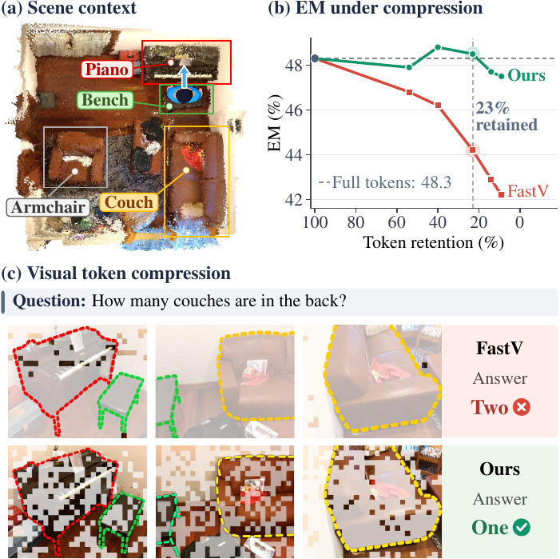
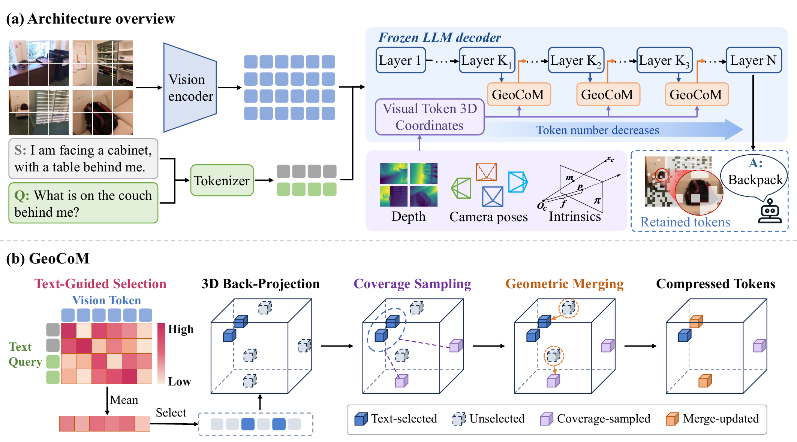

<div align="center">

# GeoCoM: Geometric Coverage and Merging for Question-Aware <br> Token Compression in Multi-View 3D Question Answering
<div>
  Wenli Li<sup>1</sup>&emsp;
  Enquan Yang<sup>1</sup>&emsp;
  Haoran Jiang<sup>1</sup>&emsp;
  Pudu He<sup>1</sup>&emsp;
  Yihan Yao<sup>1</sup>&emsp;
  Liang Chang<sup>2</sup>&emsp;
  Dan Zeng<sup>1,&dagger;</sup>
</div>
<div>
    <sup><b>1</b></sup> Shanghai University&emsp; <sup><b>2</b></sup> Innovation Academy for Microsatellites, Chinese Academy of Sciences<br>
    <sup>&dagger;</sup> Corresponding author
</div>
<br>

  
  
  

---



With only 9% of the visual tokens, GeoCoM retains at least 97.5% of the uncompressed accuracy and answers each question 1.73&times; faster. GeoCoM is a training-free token compressor for multi-view 3D question answering that uses the 3D location of every visual token to keep the scene covered and to merge repeated observations of the same surface.
</div>

---

## :rocket: **Updates**
- ⬜ **Coming Soon**: Full GeoCoM codebase and the preprint. Stay tuned!

## :open_book: **Abstract**

We study how to reduce the visual tokens that a multimodal large language model receives in multi-view 3D question answering, where many posed frames make the prefill cost grow quadratically with the sequence length. Existing training-free methods select tokens by attention or visual features alone and ignore where each token lies in the scene. Under a small budget, the retained tokens therefore concentrate in a few regions, and repeated observations of the same surface across views are treated as unrelated tokens. Since depth and camera poses already place every visual token at a 3D location, we propose Geometric Coverage and Merging (GeoCoM), a training-free method that uses these locations to address both problems. At each compression layer, GeoCoM keeps the tokens most relevant to the question and allocates a small coverage quota to the regions farthest from them. It then merges each removed token into its nearest retained token in 3D, so that observations of the same surface from different views are combined rather than discarded. Our experiments with LLaVA-OneVision on SQA3D, MSQA and Real3D-QA show that GeoCoM achieves the best average accuracy on all three benchmarks. With only 9% of the visual tokens, it retains at least 97.5% of the uncompressed accuracy and answers each question 1.73&times; faster, while no baseline retains more than 96.3%.

## :bulb: **Method**

<div align="center">

</div>

GeoCoM runs inside the frozen LLM decoder at layers {2, 6, 15}, and the visual-token budget decreases linearly over these three stages. Each stage has three steps:

1. **Text-guided selection** &mdash; rank visual tokens by text-to-vision attention and keep the most question-relevant ones.
2. **Coverage sampling** &mdash; spend a fraction &alpha; of the budget on farthest-point sampling in 3D, seeded by the tokens already kept, so regions that attention ignores still get tokens.
3. **Geometric merging** &mdash; merge every removed token into its nearest retained token in 3D, so repeated views of the same surface are combined instead of discarded.

## :bar_chart: **Results**

LLaVA-OneVision-Qwen2-7B, 12 frames per scene (8,748 visual tokens uncompressed).

| Benchmark | Metric | Avg. over 5 budgets | Margin over best baseline | Accuracy kept at 9% tokens |
|:--|:--:|:--:|:--:|:--:|
| SQA3D | EM | **48.1** | +0.7 | 98.3% |
| Real3D-QA | EM | **31.7** | +0.3 | 97.5% |
| MSQA | EM-R | **27.6** | +1.2 | 98.9% |

Budgets are 54% / 40% / 23% / 14% / 9% token retention.

## :pray: **Acknowledgements**

Our implementation builds on [LLaVA-NeXT](https://github.com/LLaVA-VL/LLaVA-NeXT) and [SparseVLM](https://github.com/Gumpest/SparseVLMs). We thank the authors for releasing their code.

## :bookmark_tabs: **Citation**
If you find our work useful for your project, please consider adding a star to this repo and citing our paper:
```bibtex
@article{li2026geocom,
  title={GeoCoM: Geometric Coverage and Merging for Question-Aware Token Compression in Multi-View 3D Question Answering},
  author={Li, Wenli and Yang, Enquan and Jiang, Haoran and He, Pudu and Yao, Yihan and Chang, Liang and Zeng, Dan},
  year={2026}
}
```
